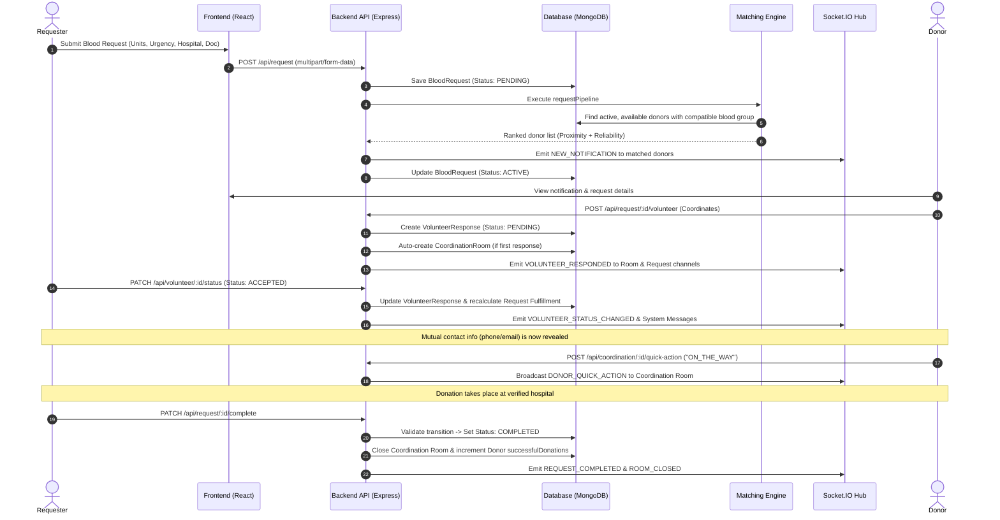
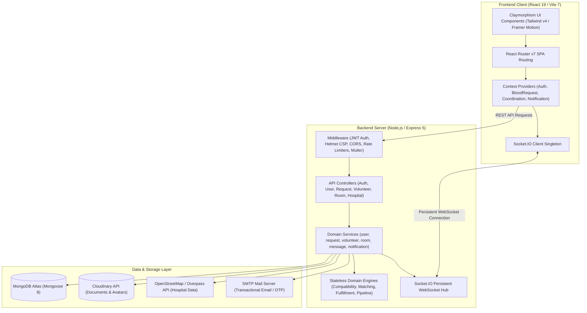
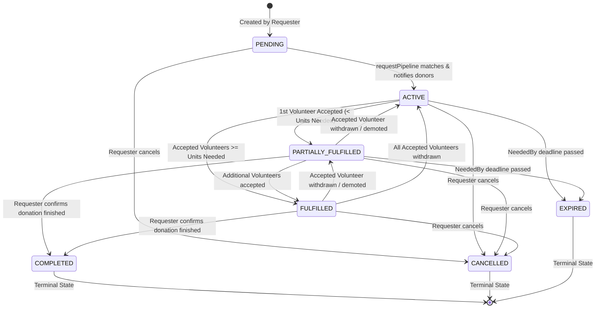

# BloodWeb

> Real-Time Blood Donation Coordination Platform

BloodWeb is an end-to-end, lifecycle-driven blood donation coordination system. Rather than serving as a static directory of phone numbers, BloodWeb coordinates real-time emergency and scheduled blood requests through biological compatibility matching, location proximity scoring, mutual volunteer acceptance, and an isolated, socket-driven Coordination Room.

---

## Table of Contents

- [Overview](#overview)
- [Key Features](#key-features)
- [How BloodWeb Works](#how-bloodweb-works)
- [Architecture](#architecture)
- [Project Structure](#project-structure)
- [Technology Stack](#technology-stack)
- [Core Domain Logic](#core-domain-logic)
  - [Blood Compatibility Matrix](#blood-compatibility-matrix)
  - [Matching & Ranking Algorithm](#matching--ranking-algorithm)
  - [Fulfillment Engine & State Calculation](#fulfillment-engine--state-calculation)
- [Request Lifecycle](#request-lifecycle)
- [API Overview](#api-overview)
- [Real-Time Events (Socket.IO)](#real-time-events-socketio)
- [Environment Variables](#environment-variables)
- [Installation & Local Setup](#installation--local-setup)
- [Configuration](#configuration)
- [Deployment Architecture](#deployment-architecture)
- [Security & Privacy Implementation](#security--privacy-implementation)
- [Screenshots](#screenshots)
- [Status & Future Improvements](#status--future-improvements)
- [Contributing](#contributing)
- [License](#license)

---

## Overview

### The Problem
During medical emergencies, finding blood donors is fragmented and chaotic:
- **Biological Incompatibility**: Relatives and friends post emergency appeals on social media and messaging apps for specific blood groups without understanding medical compatibility (e.g., searching exclusively for O+ when universal red cell donors O- or alternatives can help).
- **Stale Directories**: Static donor lists suffer from outdated contact information, lack of donor availability controls, and unverified willingness.
- **Privacy Risks**: Publicly broadcasting patient and donor phone numbers exposes both parties to unsolicited contacts and spam.
- **Communication Breakdown**: Once someone volunteers, coordination happens over phone calls and disconnected chat threads with no status tracking, route updates, or arrival confirmation.

### How BloodWeb Solves It
BloodWeb replaces informal broadcasts with a verified, automated coordination pipeline:
1. **Biological Matching**: Enforces strict donor-recipient compatibility rules through a standalone `compatibilityEngine`.
2. **Proximity & Reliability Scoring**: Ranks eligible donors by physical distance to the hospital (Haversine formula) and historical donation reliability.
3. **Controlled Contact Exchange**: Keeps phone numbers and emails private until a requester explicitly accepts a volunteer.
4. **Dedicated Coordination Rooms**: Automatically spins up an isolated, real-time room for each active request with messaging, donor transit quick-actions, cooldown throttling, and announcement pins.
5. **Stateful Completion & Crediting**: Transitions requests through strict, validated lifecycle states, closing rooms upon completion and incrementing donor reliability scores.

---

## Key Features

### Authentication & Account Management
- **Progressive Registration**: Users register with basic credentials (`name`, `email`, `password`) and complete additional profile fields (blood group, phone, DOB, location) as needed.
- **Email Verification via OTP**: 6-digit OTP delivery via Nodemailer/SMTP with bcrypt hashing, a 5-minute expiration window, and rate-limited resend logic.
- **Password Reset Flow**: Time-limited password reset codes (10-minute expiry) with anti-enumeration protection and attempt throttling.
- **Profile & Avatar Management**: Custom avatar image upload and cropping powered by Cloudinary with image buffer handling.
- **Donor Readiness Controls**: Age verification ($\ge 18$ years), blood group registration, and an availability toggle that requires complete contact and location details before activation.

### Blood Request Management
- **Structured Creation**: Requesters specify patient blood group, units needed ($1$ to $50$), urgency level (`NORMAL`, `HIGH`, `CRITICAL`), and optional target deadline (`neededBy`).
- **Hospital Verification**: Links requests to verified hospital entries with physical coordinates, preventing vague meeting points.
- **Medical Requisition Document**: Mandatory medical documentation upload (PDF or JPEG/PNG up to 5MB) processed via Cloudinary with sanitized public metadata to verify legitimacy.
- **Filterable Network Feed**: Search and filter active requests by blood group, urgency level, and city with pagination.

### Compatibility & Request Discovery
- **Biological Compatibility Engine**: Pure functional mapping of red blood cell compatibility for all 8 blood groups ($A+$, $A-$, $B+$, $B-$, $AB+$, $AB-$, $O+$, $O-$).
- **Personalized Request Feed**: Donors view blood requests where their personal blood group is medically compatible with the patient.

### Location-Based Matching
- **Haversine Distance**: Computes exact geodesic distance between donor coordinates and the destination hospital.
- **Automated Donor Discovery**: On request submission, the matching pipeline queries active, available donors within eligible blood groups, excluding the requester.
- **Composite Ranking**: Scores matching donors using weighted proximity ($70\%$) and verified completion reliability ($30\%$).

### Volunteer Management
- **Response Intake**: Donors volunteer for active requests, capturing current location coordinates (`locationAtResponse`) for accurate ETA/distance calculation.
- **Duplicate & Self-Volunteering Protection**: Requesters cannot volunteer for their own requests; donors can only volunteer once per request.
- **Requester Volunteer Actions**: Requesters can transition volunteer responses between `PENDING`, `ACCEPTED`, and `BACKUP`.
- **Withdrawal**: Donors can withdraw their volunteer response if circumstances change, automatically triggering recalculation of request fulfillment.

### Request Fulfillment
- **Derived Fulfillment Engine**: Real-time evaluation of request progress based on accepted volunteer units versus `unitsNeeded`.
- **Automated State Synchronization**: Dynamically transitions requests between `ACTIVE`, `PARTIALLY_FULFILLED`, and `FULFILLED` as volunteers are accepted, demoted to backup, or withdrawn.

### Coordination Room
- **1:1 Request Room**: Automatically created upon the first volunteer response.
- **Access Control**: Strictly restricted to the request creator and donors with non-withdrawn responses.
- **Real-Time Communication**: Event-driven WebSockets using Socket.IO for instant chat message broadcasting.
- **Donor Quick Actions**: One-click operational announcements: *"On my way to hospital"* and *"Arrived at hospital"*.
- **Admin Moderation**:
  - Message pinning for critical hospital instructions.
  - Configurable anti-spam cooldown timer (e.g., 3-second throttle for non-admin participants).
  - Message deletion by sender or room admin.
  - Administrative room closure.

### Notifications
- **Multi-Channel Dispatch**: Simultaneous in-app push notifications (Socket.IO) and structured transactional emails (Nodemailer).
- **Lifecycle Alerts**: Automated notifications for request matching, volunteer responses, acceptance, backup designation, request cancellation, and completion.
- **Actionable Notification Schema**: Notifications include deep links directly navigating users to the relevant coordination room or request page.

### Request Lifecycle & Completion
- **Verified Transitions**: Model-level state machine preventing illegal status jumps (e.g., terminal state recovery).
- **Completion Safeguard**: Requesters can only complete a request if at least one volunteer was accepted.
- **Reliability Credit**: Completing a request atomically increments `successfulDonations` for all accepted donors, increasing their platform reliability rating.

### Dashboard
- **Personal Metrics**: Live view of active requests, donation history, total volunteer count, and calculated reliability score.
- **Availability Widget**: One-click toggle for donor readiness with validation checks.
- **Recent Feed**: Chronological list of recent notifications and active blood coordination requests.

---

## How BloodWeb Works



---

## Architecture

BloodWeb is built as a modular client-server application adhering to separation of concerns between domain logic, persistence, transport, and presentation.



### Architectural Highlights
- **Domain Engines**: Pure, testable domain modules (`compatibilityEngine.js`, `matchingEngine.js`, `fulfillmentEngine.js`, `requestPipeline.js`) isolated from database drivers and network protocols.
- **Service Layer**: Encapsulates database transactions, access control checks, notification side-effects, and file lifecycle management.
- **State Machine Validators**: Dedicated transition validators (`requestStatus.transitions.js`, `volunteerStatus.transitions.js`) enforce valid state progressions before any database write occurs.
- **Field-Level Data Masking**: Requesters and donors do not have access to each other's contact details (phone, email) until an explicit mutual acceptance transition occurs.

---

## Project Structure

```text
BloodWeb/
├── docs/                               # Architectural Decision Records & Domain Specs
│   ├── Architecture.md                 # System architecture decisions
│   ├── DOMAIN_MODEL.md                 # Entity schemas and lifecycle rules
│   ├── MATCHING_ENGINE.md              # Distance & scoring formulas
│   └── NOTIFICATION_SYSTEM.md          # Multi-channel notification design
├── client/                             # React 19 Frontend (Vite 7)
│   ├── public/                         # Static assets (3D clay illustrations, logos)
│   ├── src/
│   │   ├── api/                        # Axios API service clients
│   │   ├── components/
│   │   │   ├── ClayAssets/             # Custom 3D Claymorphic avatars, drops, pedestals
│   │   │   ├── common/                 # Reusable dialogs, cards, inputs, location picker
│   │   │   ├── Dashboard/              # Dashboard summary cards and greeting feeds
│   │   │   ├── Landing/                # Landing page sections, hero scene, modals
│   │   │   ├── layout/                 # Shell, Navbar, Sidebar, Topbar, Footer
│   │   │   └── ui/                     # Primitives (Button, Card, Badge, Dialog, Input)
│   │   ├── context/                    # React Context (Auth, Request, Room, Notification)
│   │   ├── hooks/                      # Custom hooks (location, forms, timer)
│   │   ├── pages/                      # Application route pages
│   │   │   ├── Auth/                   # Login, Register, OTP, Password Reset
│   │   │   ├── Coordination/           # Coordination Room & real-time chat stream
│   │   │   ├── Dashboard/              # User metrics and status overview
│   │   │   ├── Donors/                 # Donor readiness and discovery feed
│   │   │   ├── Notifications/          # Notification inbox & filters
│   │   │   ├── Profile/                # Profile editing, avatar crop, availability
│   │   │   └── Requests/               # Request list, create wizard, detail view
│   │   ├── services/                   # Socket.IO client singleton and event listeners
│   │   ├── utils/                      # Compatibility charts, formatting, client env
│   │   ├── App.jsx                     # Route declarations & provider nesting
│   │   ├── index.css                   # Tailwind CSS v4 clay theme definitions
│   │   └── main.jsx                    # React DOM entry point
│   ├── package.json
│   ├── vercel.json                     # Frontend SPA rewrite rules
│   └── vite.config.js
└── Server/                             # Node.js / Express Backend
    ├── public/uploads/                 # Local filesystem upload fallback directory
    ├── src/
    │   ├── api/
    │   │   ├── controllers/            # Request handlers & response formatting
    │   │   └── routes/                 # Express route definitions with middleware
    │   ├── config/                     # Validated environment & database connection
    │   ├── engines/                    # Pure domain logic (Compatibility, Matching, etc.)
    │   ├── middleware/                 # Auth, Error handling, Rate limiting, Uploads
    │   ├── models/                     # Mongoose schemas, indexes, virtuals
    │   │   └── transitions/            # Finite State Machine transition validators
    │   ├── services/                   # Business domain operations & data access
    │   ├── templates/                  # Responsive HTML email templates
    │   ├── utils/                      # Socket hub, logger, emailer, OTP generator
    │   ├── app.js                      # Express application assembly & security
    │   └── server.js                   # HTTP server lifecycle, Socket.IO & DB init
    ├── tests/                          # Scaffolded integration & unit test suites
    └── package.json
```

---

## Technology Stack

| Category | Technology | Usage in BloodWeb |
| :--- | :--- | :--- |
| **Frontend Framework** | React 19 (`react`, `react-dom`) | Single-page application UI with concurrent rendering |
| **Frontend Build Tool** | Vite 7 (`vite`, `@vitejs/plugin-react`) | Rapid HMR development and optimized production bundling |
| **Styling & Design** | Tailwind CSS v4 (`@tailwindcss/vite`) | Custom Warm Claymorphism styling tokens and tactile shadows |
| **Animation** | Framer Motion & Motion | Tactile micro-interactions, modal transitions, and scene animations |
| **Routing** | React Router v7 (`react-router-dom`) | Declarative client-side routing, protected and public route guards |
| **Icons** | Lucide React | Consistent UI iconography |
| **Maps** | Leaflet & React-Leaflet | Visual hospital and donor coordinate selection |
| **Backend Framework** | Node.js (ES Modules) & Express 5 | High-performance RESTful API and route handling |
| **Database & ODM** | MongoDB Atlas & Mongoose 8 | Schema validation, spatial indexes, compound indexes, virtuals |
| **Real-Time Communication** | Socket.IO (`socket.io`, `socket.io-client`) | Bidirectional WebSocket communication for coordination rooms |
| **Authentication** | JSON Web Tokens (`jsonwebtoken`) & `bcrypt` | Stateless bearer authentication and cryptographic password hashing |
| **Security & Hardening** | Helmet (`helmet`), CORS (`cors`), Rate Limit | HTTP header protection, origin controls, route rate limiting |
| **File Storage** | Cloudinary (`cloudinary`) & Multer (`multer`) | Cloud storage for medical documents and profile avatars |
| **Email Transport** | Nodemailer (`nodemailer`) | Transactional email delivery for OTP verification and request alerts |
| **External APIs** | OpenStreetMap Overpass API | Dynamic query and local caching of real-world hospital coordinates |

---

## Core Domain Logic

### Blood Compatibility Matrix

Red blood cell compatibility is enforced strictly at the engine level via `compatibilityEngine.js`. A patient with a given blood group can only receive blood from biologically compatible donor types:

| Patient Blood Group | Compatible Donor Blood Groups | Notes |
| :---: | :--- | :--- |
| **O-** | `O-` | Universal red blood cell donor; can only receive from O- |
| **O+** | `O+`, `O-` | Can receive Rh-positive and Rh-negative O types |
| **A-** | `A-`, `O-` | Can receive A- and O- |
| **A+** | `A+`, `A-`, `O+`, `O-` | Can receive all A and O blood types |
| **B-** | `B-`, `O-` | Can receive B- and O- |
| **B+** | `B+`, `B-`, `O+`, `O-` | Can receive all B and O blood types |
| **AB-** | `AB-`, `A-`, `B-`, `O-` | Can receive any Rh-negative blood type |
| **AB+** | `AB+`, `AB-`, `A+`, `A-`, `B+`, `B-`, `O+`, `O-` | Universal red blood cell recipient |

### Matching & Ranking Algorithm

When a request is submitted, eligible donors are matched and ranked by `matchingEngine.js` using a composite score based on geodesic proximity and past donation reliability:

$$\text{Distance (km)} = \text{Haversine}(\text{Hospital Coords}, \text{Donor Coords})$$

$$\text{Proximity Score} = \frac{1}{1 + \text{Distance (km)}}$$

$$\text{Reliability Score} = \begin{cases} \frac{\text{Successful Donations}}{\text{Total Volunteer Responses}}, & \text{if Total Volunteers} > 0 \\ 0, & \text{otherwise} \end{cases}$$

$$\text{Rank Score} = (\text{Proximity Score} \times 0.7) + (\text{Reliability Score} \times 0.3)$$

*Donors with complete profiles, matching blood group, active account status, and active availability are sorted in descending order of $\text{Rank Score}$.*

### Fulfillment Engine & State Calculation

Request progress is evaluated dynamically by `fulfillmentEngine.js` by comparing the count of accepted volunteers against the requested units:

$$\text{Accepted Count} = \sum [\text{VolunteerResponse.status} == \text{'ACCEPTED'}]$$

- **`ACTIVE`**: $\text{Accepted Count} == 0$
- **`PARTIALLY_FULFILLED`**: $0 < \text{Accepted Count} < \text{Units Needed}$
- **`FULFILLED`**: $\text{Accepted Count} \ge \text{Units Needed}$

---

## Request Lifecycle

Blood request statuses are strictly controlled by `requestStatus.transitions.js`. Raw database writes cannot modify request statuses without passing transition validation.



### Transition Validation Rules

| Source Status | Allowed Target Statuses | Notes / Triggers |
| :--- | :--- | :--- |
| `PENDING` | `ACTIVE`, `CANCELLED` | Initial submission state before pipeline runs |
| `ACTIVE` | `PARTIALLY_FULFILLED`, `FULFILLED`, `CANCELLED`, `EXPIRED` | Broadcast to eligible donors; awaiting volunteers |
| `PARTIALLY_FULFILLED` | `ACTIVE`, `FULFILLED`, `COMPLETED`, `CANCELLED`, `EXPIRED` | At least 1 volunteer accepted; can be completed by requester |
| `FULFILLED` | `ACTIVE`, `PARTIALLY_FULFILLED`, `COMPLETED`, `CANCELLED` | Target units met; awaiting physical donation |
| `COMPLETED` | *None (Terminal)* | Requester confirms successful blood receipt; credits donors |
| `CANCELLED` | *None (Terminal)* | Requester cancelled request; closes room and notifies volunteers |
| `EXPIRED` | *None (Terminal)* | Target deadline passed before completion |

---

## API Overview

All routes except public status and authentication endpoints require a valid JWT passed via `Authorization: Bearer <token>`.

### 1. Authentication (`/api/auth`)
| Method | Endpoint | Description | Rate Limit |
| :--- | :--- | :--- | :--- |
| `POST` | `/api/auth/register` | Register new account (`name`, `email`, `password`) | 5 req / hour |
| `POST` | `/api/auth/login` | Authenticate with email and password | 100 req / 15 min |
| `POST` | `/api/auth/verify-otp` | Verify email address with 6-digit OTP | 5 req / 5 min |
| `POST` | `/api/auth/resend-otp` | Request a new verification code | 3 req / 15 min |
| `POST` | `/api/auth/forgot-password` | Request password reset OTP | 5 req / 15 min |
| `POST` | `/api/auth/reset-password` | Set new password with reset OTP | 5 req / 15 min |

### 2. User & Donor Profile (`/api/user`)
| Method | Endpoint | Description | Auth Required |
| :--- | :--- | :--- | :---: |
| `GET` | `/api/user/profile` | Retrieve current authenticated user profile | Yes |
| `PATCH` | `/api/user/location` | Update user physical coordinates and city details | Yes |
| `PATCH` | `/api/user/phone` | Register or update verified phone number | Yes |
| `PATCH` | `/api/user/contact-info` | Update emergency contact information | Yes |
| `PATCH` | `/api/user/blood-group` | Register donor blood group | Yes |
| `PATCH` | `/api/user/dob` | Update date of birth (enforces age $\ge 18$) | Yes |
| `PATCH` | `/api/user/availability` | Toggle donor active availability | Yes |
| `PATCH` | `/api/user/donor-readiness` | Batch update blood group, phone, and location readiness | Yes |
| `POST` | `/api/user/avatar` | Upload and crop 3D clay avatar image (Cloudinary) | Yes |
| `DELETE` | `/api/user/avatar` | Remove custom avatar | Yes |

### 3. Blood Requests (`/api/request`)
| Method | Endpoint | Description | Auth Required |
| :--- | :--- | :--- | :---: |
| `GET` | `/api/request` | Discover active requests matching search/filters | Yes |
| `GET` | `/api/request/my` | Retrieve paginated list of requests created by current user | Yes |
| `POST` | `/api/request` | Create new blood request with medical document upload | Yes |
| `GET` | `/api/request/:id` | Get detailed request info, hospital, and masked volunteer list | Yes |
| `POST` | `/api/request/:id/volunteer`| Volunteer for an active blood request | Yes |
| `GET` | `/api/request/:id/volunteers`| Get all volunteer responses for a request | Yes |
| `PATCH` | `/api/request/:id/cancel` | Cancel an active blood request | Yes |
| `PATCH` | `/api/request/:id/complete`| Confirm physical donation completed and award donor credits | Yes |

### 4. Volunteers (`/api/volunteer`)
| Method | Endpoint | Description | Auth Required |
| :--- | :--- | :--- | :---: |
| `POST` | `/api/volunteer/:id` | Submit volunteer response for request `:id` | Yes |
| `PATCH` | `/api/volunteer/:id/status` | Update response status (`ACCEPTED` or `BACKUP`) | Yes (Creator only) |
| `PATCH` | `/api/volunteer/:id/withdraw`| Withdraw volunteer response | Yes (Donor only) |
| `GET` | `/api/volunteer/request/:id`| List all volunteers for blood request | Yes |

### 5. Coordination Room (`/api/coordination`)
| Method | Endpoint | Description | Auth Required |
| :--- | :--- | :--- | :---: |
| `GET` | `/api/coordination/:requestId` | Get or instantiate room metadata for authorized participant | Yes |
| `GET` | `/api/coordination/:requestId/messages` | Retrieve room message history and cooldown state | Yes |
| `POST` | `/api/coordination/:requestId/messages` | Send chat message (enforces cooldown timer) | Yes |
| `DELETE`| `/api/coordination/:requestId/messages/:msgId` | Delete message (Sender or Room Admin only) | Yes |
| `POST` | `/api/coordination/:requestId/quick-action` | Broadcast donor quick status (*On the way*, *Arrived*) | Yes |
| `GET` | `/api/coordination/:requestId/participants` | Retrieve participant details with masked contacts | Yes |
| `PATCH` | `/api/coordination/:requestId/pin` | Pin or unpin an announcement message | Yes (Admin only) |
| `PATCH` | `/api/coordination/:requestId/cooldown`| Configure anti-spam cooldown seconds | Yes (Admin only) |
| `PATCH` | `/api/coordination/:requestId/close` | Administratively close coordination room | Yes (Admin only) |

### 6. Hospitals (`/api/hospital`)
| Method | Endpoint | Description | Rate Limit |
| :--- | :--- | :--- | :--- |
| `GET` | `/api/hospital/search` | Search hospitals by name/city (Local DB + Overpass API) | 20 req / 15 min |

### 7. Notifications (`/api/notifications`)
| Method | Endpoint | Description | Auth Required |
| :--- | :--- | :--- | :---: |
| `GET` | `/api/notifications` | Retrieve user notification inbox | Yes |
| `PATCH` | `/api/notifications/:id/read` | Mark individual notification as read | Yes |
| `PATCH` | `/api/notifications/read-all`| Mark all user notifications as read | Yes |

### 8. System Status (`/`)
| Method | Endpoint | Description | Public |
| :--- | :--- | :--- | :---: |
| `GET` | `/` | Live server status page, uptime, and database health | Yes |

---

## Real-Time Events (Socket.IO)

BloodWeb maintains persistent WebSocket connections attached to the Node.js HTTP server.

### Socket Authentication
Clients authenticate during the WebSocket handshake:
```javascript
import { io } from 'socket.io-client';

const socket = io(SERVER_URL, {
  auth: { token: localStorage.getItem('bloodweb_token') },
  transports: ['websocket', 'polling'],
  reconnection: true,
  reconnectionAttempts: 10,
});
```
*Sockets failing JWT verification are rejected before reaching event handlers.*

### Channels & Subscriptions

| Channel / Room | Subscription Method | Access Constraint |
| :--- | :--- | :--- |
| `user:<userId>` | Auto-joined on connect | Authenticated user only |
| `room:<requestId>` | `socket.emit('subscribe_room', requestId)` | Authorized requester or active volunteer |
| `request:<requestId>` | `socket.emit('subscribe_request', requestId)` | Public / authenticated users tracking request |

### Events Emitted by Server

| Event Name | Target Room | Payload | Purpose |
| :--- | :--- | :--- | :--- |
| `NEW_MESSAGE` | `room:<requestId>` | `Message` document | Real-time chat message broadcast |
| `DONOR_QUICK_ACTION` | `room:<requestId>` | `{ actionType, donorName, ... }` | Broadcast donor transit update |
| `MESSAGE_PINNED` | `room:<requestId>` | `{ pinnedMessage }` | Update pinned message in room header |
| `MESSAGE_DELETED` | `room:<requestId>` | `{ messageId }` | Remove deleted message across clients |
| `COOLDOWN_UPDATED` | `room:<requestId>` | `{ cooldownEnabled, seconds }` | Sync anti-spam cooldown settings |
| `ROOM_CLOSED` | `room:<requestId>` | `{ roomId, requestId }` | Notify clients that room was closed |
| `VOLUNTEER_RESPONDED` | `request:<id>`, `room:<id>` | `{ requestId, volunteer }` | Notify participants of new volunteer |
| `VOLUNTEER_STATUS_CHANGED`| `request:<id>`, `room:<id>` | `{ requestId, volunteer, fulfillment }` | Live fulfillment & status progress |
| `REQUEST_COMPLETED` | `request:<id>`, `room:<id>` | `{ requestId, status: 'COMPLETED' }` | Broadcast request completion |
| `REQUEST_CANCELLED` | `request:<id>`, `room:<id>` | `{ requestId, status: 'CANCELLED' }` | Broadcast request cancellation |
| `NEW_NOTIFICATION` | `user:<userId>` | `Notification` document | Instant push alert to specific user |

---

## Environment Variables

BloodWeb uses strict configuration modules (`Server/src/config/env.js` and `client/src/utils/env.js`). Variables are validated on boot; missing required variables will halt startup with an explicit error.

### Server Environment (`Server/.env`)

| Variable | Description | Required? | Default / Example |
| :--- | :--- | :---: | :--- |
| `NODE_ENV` | Runtime environment (`development`, `production`, `test`) | No | `development` |
| `PORT` | HTTP server listening port | No | `5000` |
| `FRONTEND_URL` | Base URL of frontend application (for email deep links) | **Yes** | `http://localhost:5173` |
| `MONGO_URI` | MongoDB connection string (Local or MongoDB Atlas) | **Yes** | `mongodb://127.0.0.1:27017/bloodweb` |
| `JWT_SECRET` | Cryptographic secret for signing auth tokens | **Yes** | `your_secure_random_jwt_secret_here` |
| `JWT_EXPIRES_IN` | JWT token validity duration | No | `7d` |
| `BCRYPT_SALT_ROUNDS` | Salt work factor for password hashing | No | `12` |
| `CORS_ORIGINS` | Comma-separated list of allowed client origins | No | `http://localhost:5173,http://localhost:3000` |
| `EMAIL_HOST` | SMTP server host | **Yes** | `smtp-relay.brevo.com` |
| `EMAIL_PORT` | SMTP port | **Yes** | `587` |
| `EMAIL_USER` | SMTP username / account | **Yes** | `your_smtp_username` |
| `EMAIL_PASSWORD` | SMTP password / API key | **Yes** | `your_smtp_password` |
| `EMAIL_FROM` | Sender display name and address | No | `BloodWeb <no-reply@bloodweb.in>` |
| `DOCUMENT_STORAGE_PROVIDER` | Upload storage provider (`cloudinary`) | No | `cloudinary` |
| `CLOUDINARY_CLOUD_NAME`| Cloudinary account cloud name | **Yes** (if uploads used) | `your_cloudinary_cloud_name` |
| `CLOUDINARY_API_KEY` | Cloudinary API key | **Yes** (if uploads used) | `your_cloudinary_api_key` |
| `CLOUDINARY_API_SECRET`| Cloudinary API secret | **Yes** (if uploads used) | `your_cloudinary_api_secret` |
| `RATE_LIMIT_WINDOW_MS` | Global rate limit window in milliseconds | No | `900000` (15 minutes) |
| `RATE_LIMIT_MAX` | Global maximum requests per window | No | `100` |

### Client Environment (`client/.env`)

| Variable | Description | Required? | Default / Example |
| :--- | :--- | :---: | :--- |
| `VITE_SERVER_URL` | Base URL of the backend API and Socket.IO server | **Yes** | `http://localhost:5000` |

---

## Installation & Local Setup

### Prerequisites
- [Node.js](https://nodejs.org/) (v18.x or v20.x LTS recommended)
- [MongoDB](https://www.mongodb.com/) (Local instance running on `localhost:27017` or MongoDB Atlas URI)
- [Cloudinary Account](https://cloudinary.com/) (Required for document and avatar image uploads)
- [SMTP Credentials](https://sendinblue.com/) (For email OTP dispatch; Brevo, Mailtrap, or Gmail App Password)

### 1. Clone the Repository
```bash
git clone https://github.com/codenamann/BloodWeb.git
cd BloodWeb
```

### 2. Configure Backend Server
```bash
cd Server
npm install
```

Create `Server/.env` and supply required variables:
```env
NODE_ENV=development
PORT=5000
FRONTEND_URL=http://localhost:5173
MONGO_URI=mongodb://127.0.0.1:27017/bloodweb
JWT_SECRET=super_secret_bloodweb_development_key_123!
CORS_ORIGINS=http://localhost:5173

EMAIL_HOST=smtp.mailtrap.io
EMAIL_PORT=2525
EMAIL_USER=your_smtp_user
EMAIL_PASSWORD=your_smtp_password
EMAIL_FROM=BloodWeb <no-reply@bloodweb.in>

CLOUDINARY_CLOUD_NAME=your_cloud_name
CLOUDINARY_API_KEY=your_api_key
CLOUDINARY_API_SECRET=your_api_secret
```

### 3. Start Backend Server
```bash
# Development mode with nodemon auto-restart:
npm run dev

# Or standard production mode:
npm start
```
*The backend API will start on `http://localhost:5000` and confirm MongoDB connection.*

### 4. Configure & Start Frontend Client
Open a separate terminal window:
```bash
cd client
npm install
```

Create `client/.env`:
```env
VITE_SERVER_URL=http://localhost:5000
```

Start the Vite development server:
```bash
npm run dev
```
*The client application will open on `http://localhost:5173`.*

---

## Configuration

### MongoDB Connection Resilience
`Server/src/config/db.js` configures Mongoose with connection pooling and fast-fail parameters:
```javascript
mongoose.connect(env.db.uri, {
  serverSelectionTimeoutMS: 5000, // Fails fast if cluster is unreachable at boot
  socketTimeoutMS: 45000,         // Closes inactive sockets after 45s
});
```
*The database module caches the initial connection promise to prevent duplicate connection pools during hot-reloads.*

### File Uploads (Cloudinary & Multer)
- Uploads are intercepted via `multer` using `memoryStorage()`, keeping file streams in memory buffer rather than writing unverified temp files to disk.
- Files are validated by MIME type: `application/pdf`, `image/jpeg`, `image/png`.
- Maximum file size: $5\text{MB}$.
- Avatars undergo dimension normalization and optimization via Cloudinary transformations before saving URLs to the `User` document.

### OpenStreetMap / Overpass Integration
Hospital queries execute against the OpenStreetMap Overpass API (`https://overpass-api.de/api/interpreter`). Results are cached into the local MongoDB `Hospital` collection with `source: 'OSM'` and `verified: true` to minimize external HTTP overhead and respect Overpass rate limits.

---

## Deployment Architecture

### Recommended Production Deployment

| Component | Platform | Configuration |
| :--- | :--- | :--- |
| **Backend Server** | [Render](https://render.com/) or AWS EC2 / Docker VPS | Node.js web service running `node src/server.js`. Must be a persistent server environment to maintain stateful Socket.IO WebSocket connections. |
| **Frontend Client** | [Vercel](https://vercel.com/) or [Netlify](https://netlify.com/) | Static SPA build (`npm run build`). Configured with `client/vercel.json` rewrites (`/(.*) -> /index.html`) to prevent 404s on deep React Router URLs. |
| **Database** | [MongoDB Atlas](https://www.mongodb.com/atlas) | M10+ replica set with network access restricted to backend IP / VPC. |
| **Media Storage** | [Cloudinary](https://cloudinary.com/) | Secure cloud asset storage for medical requisition forms and avatars. |
| **Email Service** | [Brevo (Sendinblue)](https://www.brevo.com/) or AWS SES | Transactional SMTP relay with high inbox deliverability. |

> **Note on Serverless Backends**: Deploying the backend to serverless runtimes (such as Vercel Functions or AWS Lambda) is not recommended because serverless containers cannot sustain long-lived WebSocket connections without external Redis pub/sub bridges and connection polling fallbacks. BloodWeb is optimized for a long-running Node.js process.

---

## Security & Privacy Implementation

- **Stateless Bearer Authentication**: Signed JSON Web Tokens with configurable expiration; verified on every private HTTP route and during the initial Socket.IO handshake.
- **Cryptographic Password Hashing**: Passwords hashed using `bcrypt` with work factor 12 before persistence; password fields set to `select: false` by default.
- **Mutual Contact Masking**: Donor phone numbers and emails are hidden until the requester accepts their response. Requester contact information is hidden from general donors until acceptance.
- **Anti-Enumeration Protection**: Forgot-password requests return an identical generic confirmation message regardless of whether the email exists in the database.
- **Strict Anti-Spam Cooldown**: Coordination Rooms support administrator-enforced cooldowns (calculated down to the millisecond) to prevent message flooding during critical emergencies.
- **HTTP Security Headers**: `helmet` sets restrictive Content Security Policies, X-Frame-Options, and X-Content-Type-Options.
- **CORS Protection**: Access strictly restricted to whitelisted frontend domains.
- **Rate Limiting**: Granular rate limits applied to sensitive routes:
  - Registration: 5 requests / hour
  - OTP Verification: 5 requests / 5 minutes
  - Hospital Queries: 20 requests / 15 minutes

---

## Screenshots

<!-- Placeholders for repository interface screenshots -->
| Landing Page | Discover Requests |
| :---: | :---: |
| `docs/screenshots/home.png` | `docs/screenshots/discover.png` |

| Request Creation Wizard | Coordination Room (Real-Time Chat) |
| :---: | :---: |
| `docs/screenshots/create-request.png` | `docs/screenshots/coordination-room.png` |

| Request Details & Volunteers | User Profile & Donor Readiness |
| :---: | :---: |
| `docs/screenshots/request-details.png` | `docs/screenshots/profile.png` |

---

## Status & Future Improvements

### Implemented & Fully Operational
- JWT Authentication, progressive registration, OTP verification, and password reset flows.
- Medical document upload to Cloudinary with sanitized metadata.
- OpenStreetMap Overpass hospital search with automatic database caching.
- Stateless blood compatibility engine and composite Haversine ranking algorithm.
- Blood request creation, listing, search, filtering, and pagination.
- Volunteer submission, duplicate response guards, and age validation ($\ge 18$).
- Coordination Room auto-creation, Socket.IO messaging, quick actions, cooldown throttling, and pins.
- Dynamic request fulfillment tracking and atomic reliability score increments on completion.
- Multi-channel notification pipeline (In-App Sockets + Responsive HTML Emails).

### Planned Future Work
- **Automated Expiry Cron**: Scheduled background job to automatically transition requests from `ACTIVE` to `EXPIRED` once `neededBy` timestamps elapse.
- **SMS & WhatsApp Dispatch**: Implementing Twilio / Meta WhatsApp Business API handlers for the scaffolded `SMS` notification channel enum.
- **Automated Test Suite**: Implementing integration and unit tests for controllers and socket handlers in `Server/tests/`.
- **Administrative Portal**: Review interface for unverified manual hospital submissions (`source: 'MANUAL'`) and formal date-of-birth correction requests (`pendingDob`).
- **Web Push Notifications**: Service Worker integration for browser push notifications when the app is closed.

---

## Contributing

1. Fork the repository.
2. Create a feature branch:
   ```bash
   git checkout -b feature/amazing-feature
   ```
3. Commit your changes:
   ```bash
   git commit -m "feat: add amazing feature"
   ```
4. Push to your branch:
   ```bash
   git push origin feature/amazing-feature
   ```
5. Open a Pull Request detailing your changes, verification steps, and relevant domain considerations.

---

## License

This repository does not currently include a formal open-source license file. All rights are reserved by the repository owner. Contact the repository maintainers for inquiries regarding reuse, modification, or distribution.
